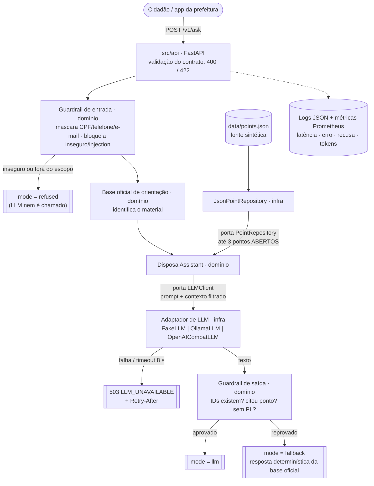
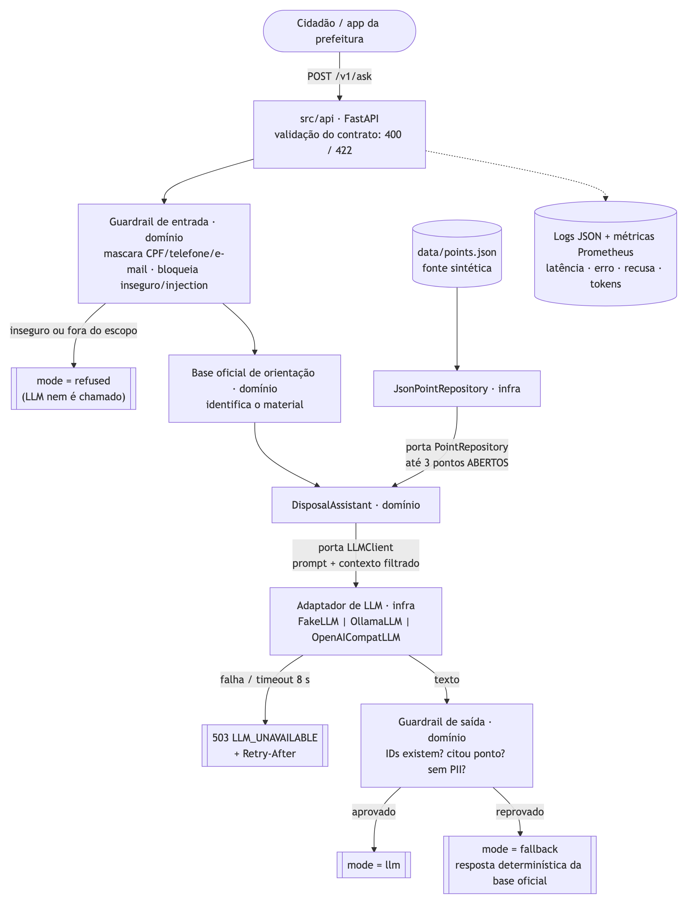
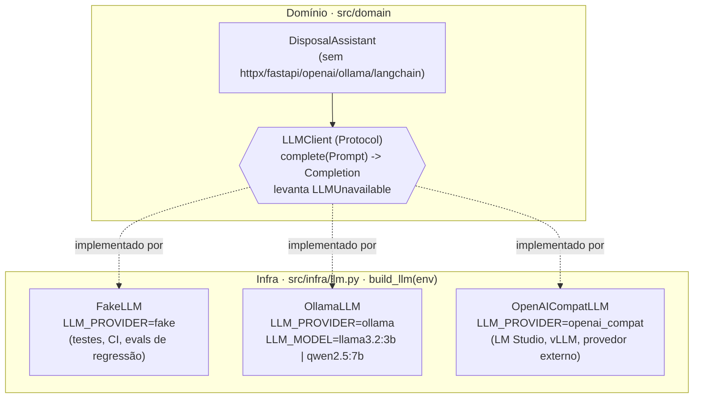
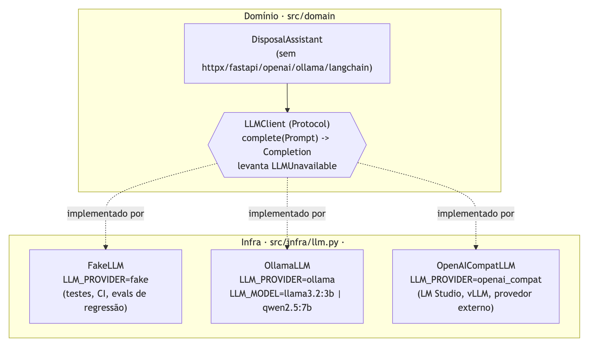

# 3. Arquitetura — ReciclaJá

> **Pergunta que esta arquitetura responde:** *"se eu tirar o LLM desse sistema e colocar outro, o que quebra?"*
> **Resposta:** nada no domínio. Muda **uma variável de ambiente** (`LLM_PROVIDER` / `LLM_MODEL`), e o adaptador correspondente em `src/infra/llm.py` entra no lugar.

## 3.1 Diagrama de componentes e fluxo

Fluxo do `POST /v1/ask`: **fonte de dados → adaptador → serviço → LLM → guardrail → resposta**.





**Leitura do fluxo**

1. A API valida o corpo contra o schema do contrato. JSON quebrado ou parâmetro inválido dá `400`, campo inválido no corpo dá `422`.
2. **Guardrail de entrada** (domínio): mascara CPF, telefone e e-mail e bloqueia pedido inseguro ou *prompt injection*. Pedido inseguro sai com `refused`, sem LLM.
3. A **base oficial** identifica o material. Se não houver material, a pergunta está fora do escopo e sai com `refused`, sem LLM e com custo zero.
4. O **serviço** busca até 3 pontos **abertos** que aceitam o material (*grounding*) pela porta `PointRepository`.
5. O **LLM** recebe só o prompt com a orientação oficial e os pontos, pela porta `LLMClient`.
6. **Guardrail de saída** (domínio): os IDs citados precisam existir no contexto, é obrigatório citar pelo menos um ponto e a resposta não pode ter PII. Se a resposta for reprovada, o cidadão recebe o **fallback** determinístico.
7. Se o LLM falhar, o adaptador levanta `LLMUnavailable` e a API devolve `503` com `Retry-After`.

## 3.2 Fronteiras: portas e adaptadores (trocar o LLM = trocar uma peça)





**Três evidências concretas da fronteira**

| Evidência | Onde |
|---|---|
| O domínio não importa biblioteca de LLM nem HTTP. Um **teste quebra o build** se alguém importar | `tests/test_domain.py::test_dominio_nao_importa_biblioteca_de_llm_nem_http` (inspeciona os imports de `src/domain` via AST) |
| Existe um **fake** do adaptador usado nos testes | `infra.llm.FakeLLM` + `tests/conftest.py` (`SpyLLM` roteirizado, `DownLLM` que simula queda) |
| Trocar o modelo é **1 linha de configuração** | `LLM_MODEL=qwen2.5:7b` no `.env`. Teste `test_trocar_llm_e_uma_linha_de_configuracao`. Rodamos o mesmo eval com `llama3.2:3b` e `qwen2.5:7b` sem mudar código (ver `5_evals_de_ia.md`) |

```bash
# Trocar de modelo — nada mais muda:
LLM_PROVIDER=ollama LLM_MODEL=qwen2.5:7b docker compose up
```

## 3.3 Ponto de extensão da IA

Uma nova capacidade de IA entra **atrás das portas**, sem tocar o domínio:

| Nova capacidade | Onde entra | O que muda no domínio |
|---|---|---|
| **Outro modelo/provedor** (Claude, GPT, Gemini, Llama via Groq) | Novo adaptador em `src/infra/llm.py` que implementa `complete(Prompt) -> Completion` e converte erros em `LLMUnavailable`. Um `if` a mais em `build_llm` | Nada |
| **RAG vetorial** sobre a cartilha completa de descarte | Novo adaptador de uma porta `GuidanceRetriever` (hoje a base é um `dict` em `knowledge.py`). O serviço passa a pedir o trecho à porta | Só a injeção da porta. Regras e guardrails continuam iguais |
| **Agente com ferramentas** (consultar status ao vivo do ecoponto) | Adaptador que implementa `LLMClient` e por dentro orquestra ferramentas. O guardrail de saída continua validando IDs contra o cadastro | Nada |
| **Fonte de dados oficial** (API de dados abertos) | Novo adaptador `PointRepository` (ex.: `OpenDataPointRepository`) | Nada |

Regra de projeto: **o guardrail de saída fica no domínio**, então qualquer IA nova passa pelas mesmas regras G1/G1b/G2.

## 3.4 ADRs (trio: 4 registros)

### ADR-01 — Porta própria com chamada HTTP direta × LangChain

| | |
|---|---|
| **Status / Data** | Aceita · 18/11/2026 |
| **Contexto** | Precisamos trocar de modelo sem reescrever o serviço e testar sem rede. O caso de uso tem **uma** chamada ao LLM por pergunta, sem cadeia nem memória. |
| **Opções** | (a) **LangChain** (`ChatOllama`, `ChatOpenAI`); (b) **SDK de cada provedor** direto no serviço; (c) **porta `LLMClient` própria + adaptadores finos com `httpx`**. |
| **Decisão** | **(c)**. Uma interface de um método (`complete(Prompt) -> Completion`) e três adaptadores de cerca de 30 linhas cada. |
| **Consequências (+)** | Domínio sem dependência de framework, o que o teste de AST garante. Fake trivial e determinístico. Cada adaptador converte qualquer falha em `LLMUnavailable`, e a API mapeia isso para `503`. Imagem Docker menor, menos CVEs. |
| **Consequências (−) / custo** | Reimplementamos o que o LangChain dá de graça: retry, streaming e *tool calling*. Se surgir agente com ferramentas (seção 3.3), avaliar LangGraph **dentro** de um adaptador. Cada provedor novo exige escrever seu adaptador. |
| **Opção descartada e por quê** | LangChain: abstração grande para uma única chamada, com API que muda com frequência e acoplaria o domínio a tipos do framework (`BaseMessage`). SDK direto: amarraria o serviço a um fornecedor. |

### ADR-02 — *Grounding* com contexto filtrado (RAG-lite determinístico) × prompt fixo × RAG vetorial

| | |
|---|---|
| **Status / Data** | Aceita · 18/11/2026 |
| **Contexto** | O cidadão precisa de **pontos reais**. Um modelo sem contexto inventa endereço, e um prompt fixo com os 24 pontos gasta tokens e confunde o modelo pequeno. |
| **Opções** | (a) **Prompt fixo** sem dados; (b) **todos os pontos** no prompt; (c) **RAG vetorial** (embeddings + Chroma/pgvector); (d) **filtro determinístico**: material por palavra-chave, depois até 3 pontos abertos que aceitam o material, priorizando o bairro. |
| **Decisão** | **(d)**, com o guardrail G1/G1b verificando na saída se os IDs citados vieram desse contexto. |
| **Consequências (+)** | Contexto pequeno (≈ 470 tokens por resposta, RNF-06). Recuperação 100% testável e explicável. Perguntas fora do escopo nem chegam ao LLM. O guardrail tem uma lista fechada de IDs para checar. |
| **Consequências (−) / custo** | A detecção de material por palavra-chave não entende sinônimos raros ("bateria de nobreak" funciona; "acumulador" não), o que gera recusa indevida (falso negativo). Mitigação: os casos de borda no eval e a métrica de taxa de recusa com alerta `RecusaForaDoPadrao`. Evolução: trocar o classificador por embeddings atrás de uma porta. |
| **Opção descartada e por quê** | RAG vetorial: infraestrutura extra (vetor DB, modelo de embedding) para uma base de 24 pontos e 10 materiais, sem ganho mensurável hoje. Prompt fixo: alucinou endereço nos testes manuais. |

### ADR-03 — Modelo local via Ollama (padrão) × API externa

| | |
|---|---|
| **Status / Data** | Aceita · 18/11/2026 |
| **Contexto** | Serviço público, perguntas de cidadão (risco LGPD), orçamento de prefeitura e exigência do brief de rodar localmente. |
| **Opções** | (a) **API externa** (OpenAI, Anthropic, Gemini); (b) **Ollama local** com modelo aberto (`llama3.2:3b`, `qwen2.5:7b`); (c) **Ollama Cloud**. |
| **Decisão** | **(b) por padrão**, com `llama3.2:3b` e prompt v2. **(a) e (c) continuam a uma variável de distância** (`openai_compat` / `LLM_BASE_URL` + `LLM_API_KEY`, chave só no ambiente). |
| **Consequências (+)** | Nenhum dado de cidadão sai da infraestrutura da prefeitura. Custo marginal por token zero. Funciona offline no CI e na banca. |
| **Consequências (−) / custo** | Modelos pequenos erram mais: no eval, o llama3.2:3b caiu no fallback em **31,8%** das respostas, e o qwen2.5:7b teve p95 de **14 s** em CPU/GPU de notebook. Produção exige servidor com GPU. Até lá, a solução **só vai para piloto** (ver critério de rollout). |
| **Opção descartada e por quê** | API externa como padrão: envio de texto livre do cidadão a terceiro exige base legal e contrato, custo por token cresce com o uso e cria dependência de disponibilidade externa. Fica como plano B documentado. |

### ADR-04 — O que fazer quando o modelo erra: fallback determinístico × recusa × erro

| | |
|---|---|
| **Status / Data** | Aceita · 18/11/2026 |
| **Contexto** | O guardrail de saída reprova respostas (ponto inventado, sem citação, PII). Precisamos decidir o que o cidadão recebe. |
| **Opções** | (a) Devolver **erro 5xx**; (b) **recusar** ("não sei"); (c) **tentar de novo** o LLM (retry); (d) **fallback**: resposta montada pela base oficial e pelos pontos do contexto, com `mode = "fallback"`. |
| **Decisão** | **(d)**. Erro `503` fica reservado para **indisponibilidade** do provedor, não para erro de conteúdo. |
| **Consequências (+)** | O cidadão sempre recebe orientação correta (taxa de resposta correta de 100% no eval v2). O campo `mode` torna o erro do modelo **visível** para métricas e alertas (`reciclaja_ask_outcomes_total{mode="fallback"}`). Custo e latência previsíveis, sem retry. |
| **Consequências (−) / custo** | O fallback é menos natural ("texto de cartilha"). Uma taxa alta de fallback esconde um modelo ruim, por isso existe a meta `taxa_fallback ≤ 20%` para ir a público e o alerta `FallbackGuardrailAlto`. |
| **Opção descartada e por quê** | Retry: dobra a latência (estoura o RNF-01) e o modelo tende a repetir o erro com `temperature = 0`. Recusa: o cidadão fica sem resposta mesmo tendo dado oficial disponível. |

## 3.5 Observabilidade

**Log estruturado (JSON, stdout)**: um evento por requisição e um por `/ask`. **Nunca logamos o texto da pergunta nem da resposta**, só metadados.

```json
{"level": "INFO", "event": "ask", "request_id": "3f9a1c0b2d4e", "mode": "fallback", "reason": "none",
 "material": "lampada", "provider": "ollama", "model": "llama3.2:3b", "tokens_in": 412, "tokens_out": 61,
 "violations": ["sem_citacao"], "latency_ms": 1408.2}
```

**Métricas Prometheus** (`GET /metrics`, coletadas pelo Prometheus do `docker compose`):

| Métrica | O que mede |
|---|---|
| `reciclaja_http_requests_total{route,method,status}` | Volume e **taxa de erro** por rota |
| `reciclaja_http_request_seconds{route}` (histograma) | **Latência** p50/p95 |
| `reciclaja_ask_outcomes_total{mode,reason}` | **Taxa de recusa** (`refused`), **fallback** e 503 |
| `reciclaja_llm_calls_total{provider,model,outcome}` | Chamadas ao LLM e falhas por modelo |
| `reciclaja_llm_seconds{provider}` | Latência só do LLM |
| `reciclaja_llm_tokens_total{provider,direction}` | **Custo/tokens** de entrada e saída |
| `reciclaja_guardrail_blocks_total{violation}` | Qual regra está reprovando o modelo |

**Alertas** (`4_slice/ops/alerts.yml`, carregados no Prometheus):

| Alerta | Condição que dispara | Ação |
|---|---|---|
| `AskLatenciaP95Alta` | p95 de `/v1/ask` **> 4 s por 10 min** | Verificar carga do servidor de modelo; considerar modelo menor |
| `TaxaErro5xxAlta` | **> 5%** das requisições com 5xx em 5 min | Provedor de IA fora: comunicar, `/points` segue no ar |
| `FallbackGuardrailAlto` | **> 20%** das respostas em fallback por 30 min | Modelo/prompt degradou: rodar eval e voltar para a versão anterior |
| `RecusaForaDoPadrao` | Recusa **> 40%** por 1 h | Cidadãos pedindo algo não coberto: revisar palavras-chave/escopo |
| `ConsumoTokensAlto` | **> 2 milhões** de tokens/dia | Revisar custo antes da fatura (relevante se trocar para API externa) |

Cada resposta carrega `X-Request-ID` (aceita o do cliente), que permite correlacionar log, métrica e reclamação do cidadão.

## 3.6 Segurança

| Camada | Controle | Onde |
|---|---|---|
| **Validação de entrada** | Schema estrito (`extra="forbid"`, `minLength`/`maxLength`, `pattern` no ID, enums), com `400`/`422` | `src/api/schemas.py`, `2_contrato_api.yaml` |
| **Sanitização** | Mascaramento de CPF, telefone e e-mail **antes** do LLM e do log. Bloqueio de pedido inseguro e de *prompt injection* | `src/domain/guardrails.py` (G2, G3) |
| **Saída** | O LLM nunca responde direto: o guardrail valida IDs e PII. O fallback é determinístico | `guardrails.output_violations` |
| **Proibição de chave em código** | Chave só por `LLM_API_KEY` no ambiente. `.env` no `.gitignore` e no `.dockerignore`. `.env.example` sem valores. **Gitleaks no CI** | `.env.example`, `.github/workflows/ci.yml` |
| **Superfície mínima** | OpenAPI gerado e `/docs` desligados (uma fonte de verdade só, o YAML). Container roda como usuário não-root. Erro 500 genérico sem stack trace | `src/api/app.py`, `Dockerfile` |
| **Análise estática** | `ruff` com regras `S` (bandit) no CI | `pyproject.toml` |

## 3.7 Estrutura do código

```
4_slice/
├── src/
│   ├── domain/      # models, ports (Protocol), knowledge, guardrails, service — Python puro
│   ├── infra/       # repository_json, llm (fake/ollama/openai_compat), observability
│   ├── api/         # app (FastAPI, handlers de erro), schemas (DTOs = contrato)
│   └── main.py      # composition root para o uvicorn
├── tests/           # 38 testes: API, contrato (schema × resposta), domínio, gate de evals
├── evals/           # cases.json (30 casos) + run_evals.py + relatórios por modelo
├── data/points.json # cadastro sintético (scripts/gen_points.py)
├── ops/             # prometheus.yml + alerts.yml
├── Dockerfile · docker-compose.yml · .env.example
└── .github/workflows/ci.yml  # cópia do workflow da raiz do repositório
```
