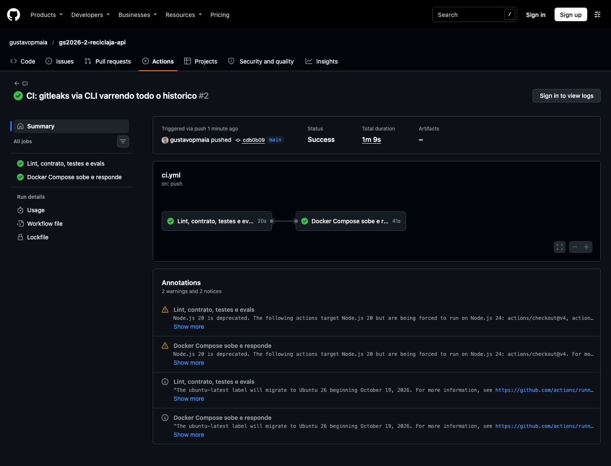
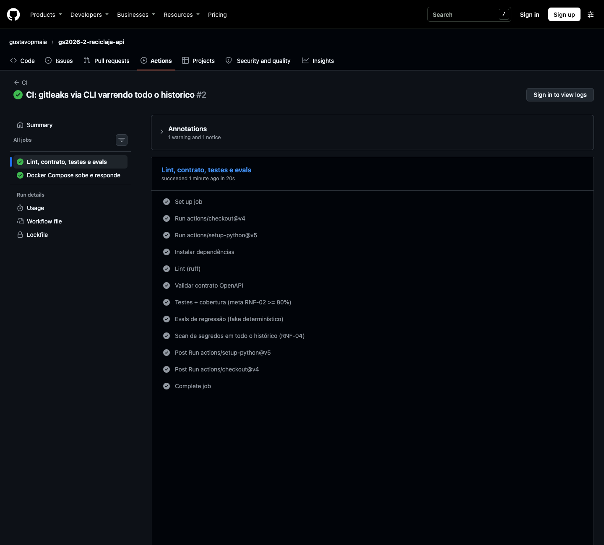
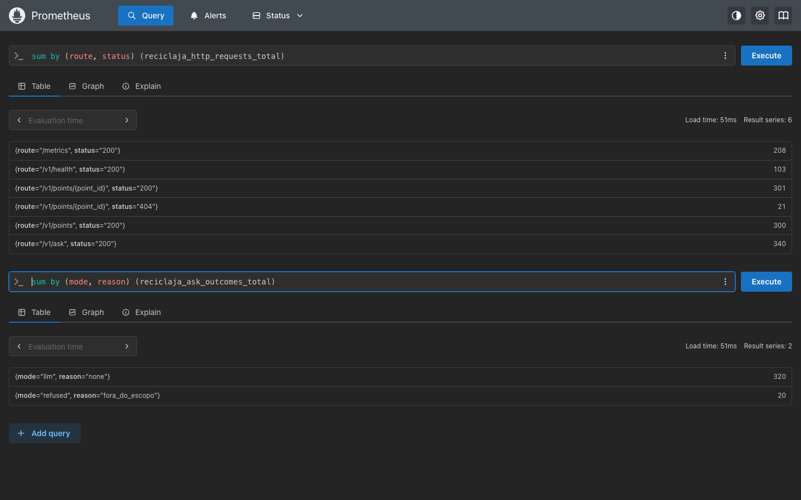
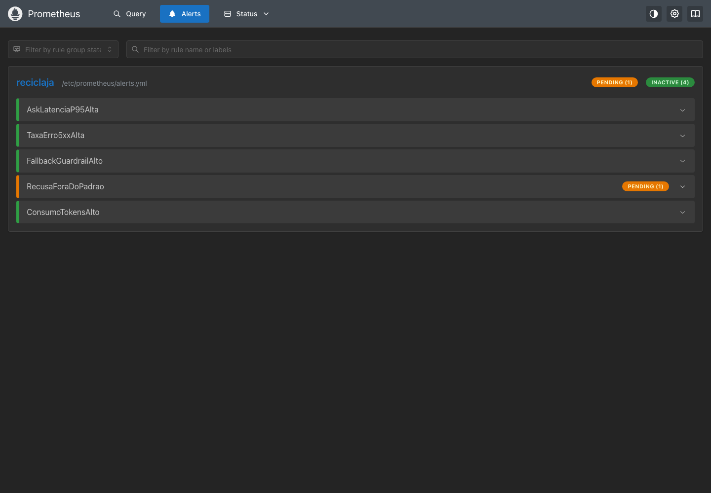

# ReciclaJá — GS2026.2 · Prompt and Artificial Intelligence

**Engenharia de Software · Turma 2CCPY-2026 · Frente C ♻️ Descarte e sustentabilidade · Trio**

| Integrante | RM |
|---|---|
| Gabriel Fidalgo | RM563213 |
| Gustavo Maia | RM562240 |
| Gustavo Rossi | RM566075 |

**Repositório:** https://github.com/gustavopmaia/gs2026-2-reciclaja-api
**CI (GitHub Actions):** https://github.com/gustavopmaia/gs2026-2-reciclaja-api/actions

> O piloto do assistente de descarte saiu do "notebook" e virou um **serviço com contrato**. O serviço recusa o que não sabe, não inventa ponto de coleta, mascara dado pessoal, troca de LLM com uma variável de ambiente e tem evals que decidem se ele pode ir para o público.

---

## Índice do dossiê

| # | Arquivo | Conteúdo |
|---|---|---|
| 1 | [`1_visao_produto.md`](1_visao_produto.md) | Persona (Dona Cida), problema, 7 RF, 6 RNF com número, 8 critérios Dado/Quando/Então, fora de escopo, riscos |
| 2 | [`2_contrato_api.yaml`](2_contrato_api.yaml) | OpenAPI **3.1.0**: 4 endpoints, schemas com `enum`/`required`, erro único 400/404/422/503, paginação `limit`/`offset`/`next` |
| 3 | [`3_arquitetura.md`](3_arquitetura.md) | Diagrama do fluxo, portas/adaptadores, **4 ADRs**, ponto de extensão, observabilidade com alertas, segurança |
| 4 | [`4_slice/`](4_slice/) | Código real: `src/domain`, `src/infra`, `src/api`, 38 testes, evals, Docker Compose, CI |
| 5 | [`5_evals_de_ia.md`](5_evals_de_ia.md) | 30 casos, métrica com meta, 5 guardrails, regressão, rollout, **resultados reais com 2 modelos** |
| 6 | `6_README.md` | Este arquivo |
| 7 | [`7_demo_video_url.txt`](7_demo_video_url.txt) | Link do vídeo (≤ 3 min, não listado) |
| 8 | [`8_certificacao.txt`](8_certificacao.txt) | Cola compacta: links, números, nomes e RMs |
| 9 | [`9_Chat_Log.txt`](9_Chat_Log.txt) | Registro do uso de IA |

## Como rodar

### Opção A — `pytest` (sem Docker, sem LLM)

```bash
cd 4_slice
python3.12 -m venv .venv && source .venv/bin/activate
pip install -r requirements-dev.txt
pytest --cov --cov-fail-under=80        # 38 testes, cobertura 96%
```

### Opção B — `docker compose up` (API + Prometheus)

```bash
cd 4_slice
docker compose up --build               # API em :8000, Prometheus em :9090
```

Por padrão a API sobe com o **`FakeLLM`** (determinístico, sem rede). Para usar um modelo real:

```bash
ollama pull llama3.2:3b
LLM_PROVIDER=ollama LLM_MODEL=llama3.2:3b docker compose up --build   # trocar o modelo = trocar esta linha
```

### Validar o contrato

```bash
$ openapi-spec-validator 2_contrato_api.yaml
2_contrato_api.yaml: OK
```

### Rodar os evals

```bash
cd 4_slice
python evals/run_evals.py                                             # fake (o mesmo do CI)
LLM_PROVIDER=ollama LLM_MODEL=llama3.2:3b python evals/run_evals.py   # modelo real
```

## Requisições reais (saída copiada do terminal, stack do `docker compose`)

```text
$ curl -s localhost:8000/v1/points/PC-001
{"id":"PC-001","name":"Ecoponto Mooca 1","type":"ecoponto","neighborhood":"Mooca","address":"Av. das Flores, 646",
 "latitude":-23.55887,"longitude":-46.59333,"materials":["entulho","metal","papel","vidro","volumoso"],"status":"aberto",
 "opening_hours":"Ter a Sáb, 9h às 18h","updated_at":"2026-11-13T18:00:00Z","data_source":"sintetico"}
HTTP 200

$ curl -s localhost:8000/v1/points/PC-999
{"error":{"code":"NOT_FOUND","message":"Ponto de coleta PC-999 não encontrado","details":[],"request_id":"557050d85628"}}
HTTP 404

$ curl -s localhost:8000/v1/points/abc
{"error":{"code":"BAD_REQUEST","message":"Requisição malformada","details":[{"field":"path.point_id",
 "issue":"String should match pattern '^PC-[0-9]{3}$'"}],"request_id":"6c57982779b3"}}
HTTP 400

$ curl -s "localhost:8000/v1/points?material=pilha_bateria&limit=2"
{"items":[{"id":"PC-008",...},{"id":"PC-012",...}],"total":4,"limit":2,"offset":0,
 "next":"/v1/points?material=pilha_bateria&limit=2&offset=2"}
HTTP 200

$ curl -s -X POST localhost:8000/v1/ask -H 'Content-Type: application/json' \
       -d '{"question":"Onde jogo pilhas usadas?","neighborhood":"Butantã"}'
{"answer":"Pilhas e baterias nunca vão no lixo comum: leve a um ponto de logística reversa (ecoponto ou comércio
 participante). Você pode levar em: [PC-008] Ponto Comercio Butantã 8; [PC-016] Ponto Comercio Butantã 16;
 [PC-024] Ponto Comercio Butantã 24.","mode":"llm","material":"pilha_bateria",
 "cited_points":["PC-008","PC-016","PC-024"],"refusal_reason":null,
 "disclaimer":"Orientação automática baseada em dados sintéticos de demonstração. Confirme horários no local.",
 "request_id":"4b8c970414a4"}
HTTP 200

$ curl -s -X POST localhost:8000/v1/ask -H 'Content-Type: application/json' -d '{"question":"a"}'
{"error":{"code":"VALIDATION_ERROR","message":"Corpo da requisição inválido","details":[{"field":"body.question",
 "issue":"String should have at least 3 characters"}],"request_id":"54c3e4418c3f"}}
HTTP 422
```

## Evidências de CI (prints reais do GitHub Actions)

Run verde: https://github.com/gustavopmaia/gs2026-2-reciclaja-api/actions/runs/44362242694





O pipeline (`.github/workflows/ci.yml`) roda, nesta ordem:

1. `ruff` (lint + format).
2. `openapi-spec-validator` no YAML.
3. `pytest` com cobertura mínima de 80%.
4. Evals de regressão com o fake.
5. **Gitleaks** em todo o histórico.
6. Job de **Docker Compose**: sobe a stack e faz smoke test do contrato (200, 404, `/ask`).

## Observabilidade (bônus: Prometheus com métrica real coletada)

O `docker compose` sobe o Prometheus coletando `/metrics` da API e carrega as 5 regras de alerta de `ops/alerts.yml`:





No print, `RecusaForaDoPadrao` aparece em **PENDING**. Isso é real: geramos de propósito uma rajada de perguntas fora do escopo para ver a regra avaliar. Ela só dispara se a condição persistir por 1 h.

## Testes (38): cobertura do que o brief pede

| Exigência | Teste |
|---|---|
| Caminho feliz | `test_get_point_happy_path`, `test_ask_happy_path_com_fake`, `test_list_points_filtra_e_pagina` |
| Erro | `test_get_point_inexistente_retorna_404`, `..._id_malformado_retorna_400`, `test_ask_pergunta_curta_retorna_422`, `test_ask_json_malformado_retorna_400`, `test_ask_llm_indisponivel_retorna_503` |
| **Contrato** (schema × resposta real, bônus) | `assert_contract` em `conftest.py` valida o corpo de cada resposta contra o schema **do YAML**. `test_rotas_do_codigo_batem_com_o_contrato` compara as rotas do YAML com as do código |
| **Fake do LLM** (determinismo) | `FakeLLM`, `SpyLLM` (roteirizado), `DownLLM` (queda). **Nenhum teste chama LLM real** |
| Guardrails | fora do escopo, inseguro, *prompt injection*, PII mascarada, ponto inventado, PII na saída, sem citação |
| Fronteira do domínio | `test_dominio_nao_importa_biblioteca_de_llm_nem_http` (AST), `test_trocar_llm_e_uma_linha_de_configuracao` |
| Regressão de IA | `test_evals_com_fake_aprovam_todas_as_metas` |

## Decisões explicadas (resumo, detalhes nos ADRs)

| Decisão | Por quê | Custo assumido |
|---|---|---|
| Porta `LLMClient` própria em vez de LangChain (ADR-01) | Uma chamada por pergunta. Domínio sem framework. Fake trivial | Reescrever retry/streaming se precisar |
| Grounding com filtro determinístico em vez de RAG vetorial (ADR-02) | 24 pontos e 10 materiais: filtro é testável e barato (≈ 470 tokens/resposta) | Palavra-chave não entende sinônimos raros |
| Ollama local como padrão (ADR-03) | Dado de cidadão não sai da prefeitura. Custo por token zero | Modelo pequeno erra mais, o que nos manteve no **piloto** |
| Fallback determinístico quando o modelo erra (ADR-04) | O cidadão sempre recebe orientação oficial correta | Texto menos natural, vigiado pela meta de fallback ≤ 20% |

## Notas de alinhamento YAML × código

- Os nomes de campo, enums e status são idênticos. Testes automatizados garantem isso (`assert_contract` + comparação de rotas).
- `GET /metrics` existe no código e **não** está no YAML **de propósito**: é endpoint operacional de scrape do Prometheus, fora do contrato de negócio. O teste de rotas o exclui explicitamente.
- O OpenAPI gerado pelo FastAPI está **desligado**, para que a única fonte de verdade seja o `2_contrato_api.yaml`.
- `ci.yml`: o GitHub só executa workflows na raiz do repositório (`.github/workflows/ci.yml`). A cópia em `4_slice/.github/workflows/ci.yml` existe para o zip seguir a estrutura pedida.

## Dados

Todos os 24 pontos são **sintéticos** (`4_slice/scripts/gen_points.py`, seed 2026) e marcados com `data_source = "sintetico"`. Nenhum dado pessoal real foi usado. Nenhuma chave de API está no repositório (verificado pelo Gitleaks no CI).
